# Mastering Pro — Auditoría técnica y propuesta de mejora

> Fecha: 2026-11-16 · Alcance: `desktop-client/src/modules/mastering-pro/**` (≈ 11 000 líneas) · Commit auditado: `9d4a839`
> Método: lectura completa del motor DSP + **mediciones objetivas** ejecutando el motor *real* en Chromium headless (mismo motor que WebView2/Tauri). Los scripts y resultados crudos están en [`evidence/`](./evidence/).
> No se modificó ningún archivo del producto. Este documento solo diagnostica y propone.

---

## 0. Resumen ejecutivo (lo que explica "no me convence cómo suena")

El problema **no es que el export no aplique tus cambios** (en 19 variantes de parámetros probadas, las 19 modifican el WAV exportado). El problema es que **la cadena está mal calibrada y el limitador final destruye la dinámica**, y los medidores de la UI **no muestran valores reales**, así que no hay forma de darse cuenta.

| # | Hallazgo (medido) | Gravedad |
|---|---|---|
| 1 | **El control "Target LUFS" no funciona.** Mismo audio, target −14 / −9.5 / −8 LUFS → salida **−6.98 / −6.55 / −6.43 LUFS**. Siempre sale ~−6.5 LUFS. | 🔴 Crítico |
| 2 | **Salida entre 2.7 y 4.3 LU más fuerte que el objetivo** (p. ej. objetivo −9.5 → real −6.4). Crest factor aplastado de **12.3 dB → 3.8–5.6 dB** (hasta 1.8 % de las muestras pegadas al techo = recorte). Es el sonido "plano/saturado". | 🔴 Crítico |
| 3 | **El techo True Peak no se respeta.** Ceiling −1.0 dBTP → export real **−0.77 a −0.84 dBTP**; cadena en vivo **−0.63 dBTP**. | 🔴 Crítico |
| 4 | **El compresor nativo de WebAudio añade ganancia automática** (+4.6 dB con thr −18/ratio 2; **+8.5 dB** con thr −24/ratio 3 — medidos; ≈ +8 dB con el preset por defecto 4:1 — calculado con la misma fórmula) **y 6 ms de latencia**. En modo paralelo mezcla una rama "wet" más fuerte y retrasada con la "dry" → **filtro peine**: −8 dB @83 Hz, +3.4 dB @166 Hz, −3.6 dB @250 Hz. | 🔴 Crítico |
| 5 | **Los medidores en vivo son parcialmente inventados**: parado, muestran el target como "LUFS salida" y el techo como "True Peak"; en reproducción el LUFS es un RMS de 1024 muestras ×1.45 sin K-weighting; el True Peak se recorta con `Math.min(ceiling, …)` (nunca muestra excesos). | 🔴 Alto |
| 6 | **El análisis espectral está roto para canciones reales**: submuestrea sin filtro anti-alias (`stride`≈68 en una pista de 3 min ⇒ fs efectiva ≈ 705 Hz) y fija todas las bandas altas a ~300 Hz. Resultado: *presence/air/sibilancia/AI-score/resonancias/recomendación de preset* son ruido. Prueba: pista **sin** agudos reporta `air −14.6 dB`; la misma con un tono fuerte a 12 kHz reporta `−15.5 dB`. | 🔴 Alto |
| 7 | **Export ≠ lo que escuchas en vivo.** Export añade (a) un "cloak" offline (notch 19.85 kHz + 3 all-pass) y (b) un limitador lookahead distinto *después* del grafo. Prueba nula (null test) vs grafo en vivo: residuo −6.6 dB (debería ser ≤ −90 dB), el export sale 0.47 LU más bajo y con TP distinto (−0.78 vs −0.63 dBTP). | 🟠 Alto |
| 8 | **A/B sesgado**: el "Gain-Match" usa el LUFS de entrada vs el *target*, no la salida real (que sale +3 LU más alta) ⇒ lo masterizado siempre suena "mejor" por ser más fuerte. | 🟠 Medio-alto |
| 9 | Auto-notches: se aplican **siempre 3 notches** (−3 a −5.8 dB, Q 12) a pistas cortas aunque no haya resonancia; en pistas largas ninguno (por el bug 6). | 🟠 Medio |

**Conclusión:** hay que (1) calibrar el *gain staging*, (2) cambiar el limitador estático por un limitador lookahead real con True Peak ITU, (3) hacer el export "dos pasadas" con medición LUFS real y verificación, (4) unificar vivo/export en un único pipeline y (5) arreglar el análisis. Con eso el master será medible, repetible y no estará "aplastado". Detalle y plan en §4–§6.

---

## 1. Arquitectura actual (cadena de señal)

```mermaid
flowchart LR
  SRC[AudioBufferSource<br/>playbackRate = modo CQT] --> IN[inputNode]
  IN --> HPF[HPF 18-60Hz]
  HPF --> EQS[6 bandas EQ stereo<br/>Biquad] --> NOTCH[4 notches Q12] --> MUD[78Hz mud-suppress]
  MUD --> MS[M/S matrix<br/>EQ mid + EQ side + mono-maker + width]
  MS --> DUCK[2 peaking duck<br/>72Hz / 245Hz]
  DRUMS[Capas bombo/caja<br/>1 BufferSource+Gain+Biquad POR GOLPE] --> SUM
  DUCK --> SUM[preGlueSum]
  SUM --> COMP[DynamicsCompressorNode NATIVO<br/>+makeup auto +6ms]
  SUM --> DRY[dry sin retardo]
  COMP --> MK[makeup extra] --> WET[wet mix] --> S4A
  DRY --> S4A[sum]
  S4A --> SAT[Saturador WaveShaper 4x<br/>+ DC blocker + tilt + trim]
  SAT --> HUM[Humanizer: shelves, all-pass x4,<br/>exciter, convolver, ruido]
  HUM --> DRIVE[maximizerDriveGain<br/>= makeup estimado]
  DRIVE --> SAFE[DynamicsCompressorNode ratio 16<br/>'safety limiter']
  SAFE --> BW[WaveShaper tanh 'brickwall']
  BW --> OUT[outputNode]
  OUT -->|export| CLOAK[Cloak offline: notch+3 all-pass] --> LIM[Limitador lookahead offline 2ms] --> WAV[WAV 24-bit TPDF]
```



Observaciones estructurales:
- Todo el DSP usa nodos nativos, **no hay AudioWorklet** → no hay compresión/limitación "reales", ni medición K-weighted, ni True Peak ITU en vivo.
- Tres etapas no lineales en cascada (saturador → humanizer/exciter → safety → brickwall) sin *headroom staging*.
- El export **no** es "el mismo grafo": añade 2 procesos JS tras renderizar (§3.7).

---

## 2. Evidencia medida (resumen)

Entorno: Chrome headless, `OfflineAudioContext` 48 kHz, motor real vía `exportMasterToWav24Bit`. Señal: mezcla sintética densa (bajo+bombo+caja+hats+pads+lead), 8–14 s. Datos crudos: [`evidence/result.json`](./evidence/result.json), [`evidence/result2.json`](./evidence/result2.json). Reproducir: `node evidence/run.mjs` (requiere Chrome y `desktop-client/node_modules`).

### 2.1 Export vs. objetivo (preset por defecto y otros)

| Preset | LUFS entrada | Target | **LUFS salida** | Error | TP salida (techo −1.0) | Crest entrada→salida |
|---|---|---|---|---|---|---|
| stadium-pop-rock | −19.8 | −9.5 | **−6.71** | +2.79 | −0.79 | 12.3 → 5.6 |
| stadium-pop-rock | −13.8 | −9.5 | **−6.44** | +3.06 | −0.77 | 12.3 → 5.3 |
| nu-disco-funk | −19.8 | −9.0 | **−5.17** | +3.83 | −0.79 | 12.3 → **3.8** (1.8 % muestras en el techo) |
| modern-worship | −13.8 | −10.5 | **−6.25** | +4.25 | −0.83 | 12.3 → 5.0 |
| crisp-latin-pop | −13.8 | −8.5 | **−5.84** | +2.66 | −0.79 | 12.3 → 4.5 |

### 2.2 El Target LUFS no controla nada

Mismo audio y preset, solo cambia `targetLufs`:

| targetLufs | −14 | −9.5 (base) | −8 |
|---|---|---|---|
| LUFS salida | −6.98 | −6.55 | −6.43 |

→ Rango total de 0.55 LU para un rango pedido de 6 LU: el limitador se come toda la diferencia.

### 2.3 Compresor nativo (Chromium)

| thr / ratio | Ganancia con señal *muy por debajo* del umbral |
|---|---|
| −18 / 2:1 | **+4.55 dB** |
| −24 / 3:1 | **+8.53 dB** |
| −12 / 1.5:1 | +1.81 dB |
| Latencia (look-ahead interno) | **6.00 ms** |

Respuesta en frecuencia de la mezcla paralela 50/50 (ruido): 40 Hz +0.2 · **83 Hz −8.0** · 100 Hz −4.9 · **166 Hz +3.4** · 250 Hz −3.6 · 333 Hz +3.1 · ≥500 Hz ≈ +2.1…+3.0 dB ⇒ peine de ±8 dB en graves/low-mid (el rango más sensible de un máster).

### 2.4 ¿Se aplica cada cambio al export? (sensibilidad, 19 variantes)

| Parámetro modificado | ¿Cambia el WAV? | Nota |
|---|---|---|
| Sub punch, Anti-mud, Presence, De-harsh, De-sib, Side-air | ✅ | Δ medidas en la banda correcta (p. ej. sibilancia −6 dB → −5.0 dB @6.2 kHz) |
| Width 0 % / 150 % | ✅ | Side −11.8 dB / +4.7 dB (**0 % no es mono real**, §3.9) |
| Mono-maker, HPF, Saturación, Glue mix, Umbral/ratio | ✅ | |
| Ceiling −3 dB | ✅ | TP −2.71 |
| Humanizer ON/OFF, Modo CQT 432 Hz, Drum layering | ✅ | CQT altera la **duración** (8 s → 8.148 s) y la afinación |
| **Target LUFS** | ⚠️ efecto casi nulo | §2.2 |
| *Efecto neto de EQ* | ⚠️ atenuado | +6 dB de presencia @2.8 kHz ⇒ solo +1.7 dB en salida y el resto de bandas bajan 3–7 dB: el limitador "devuelve" lo que el EQ sube |

Interpretación: **tus cambios sí viajan al export**, pero la etapa final los neutraliza parcialmente porque el nivel llega al limitador ~7–10 dB más caliente de lo previsto.

### 2.5 Análisis espectral (bug de decimación)

Pista sintética con/sin: tono 12 kHz ("aire"), 6.2 kHz (sibilancia), línea 3.85 kHz (resonancia).

| Duración | Perfil `air` limpia → con 12 kHz | Resonancia 3.85 kHz detectada |
|---|---|---|
| 6 s | −28.7 → −17.7 (✔ funciona) | ✔ |
| 20 s | −23.9 → −12.2 | ✘ (propone 2150 Hz) |
| **180 s** | **−14.6 → −15.5 (inverso)** | **✘ ninguna** |

---

## 3. Hallazgos detallados (inconsistencias y bugs)

Leyenda: 🔴 crítico · 🟠 alto · 🟡 medio · ⚪ menor. Líneas referidas a `mastering-pro/`.

### 3.1 Gain staging y loudness (🔴)
- `engine/WebAudioMasteringEngine.ts:154-162` — `computeTargetMakeupGainDb = target − LUFS_in − 1.4` (clamp −8…+12). Supone que la cadena solo suma 1.4 dB; en realidad suma ~+7…+10 dB (compresor nativo +4.6…+8.5 dB, makeup del preset, makeup adaptativo, drive del saturador). Se acumula antes del limitador.
- `engine/MasteringGraphBuilder.ts:59-73` — makeup adaptativo (hasta +9 dB) se suma al auto-makeup nativo, sin conocimiento de él.
- `engine/AnalogSaturationCurves.ts` + `MasteringGraphBuilder.ts:218-270` — el saturador recibe la señal ya caliente; el `WaveShaperNode` **recorta en ±1.0** todo lo que llega por encima (el dominio del shaper es [−1,1]) ⇒ distorsión dura *antes* del maximizador.
- Hay **dos fórmulas distintas** de auto-makeup (`SpectralDeltaAnalyzer.ts:861-864` usa −1.2 y clamp −6…+14; el engine usa −1.4 y −8…+12); la del analizador no se usa.

### 3.2 Compresor de bus (🔴)
- `MasteringGraphBuilder.ts:187-213` — `DynamicsCompressorNode`: (a) makeup automático no desactivable, (b) 6 ms de retardo, (c) dry sin retardo ⇒ **peine** (medido §2.3), (d) sin sidechain HPF, sin control RMS/peak, release "por zonas" fijo.

### 3.3 Limitador (🔴)
- `engine/TruePeakLimiter.ts:10-38` — el "brickwall" es un **WaveShaper estático tanh** (clipper suave sin memoria): genera distorsión armónica proporcional al exceso, no es un limitador. `LimiterConfig.lookaheadMs` no se usa en vivo.
- `MasteringGraphBuilder.ts:275-345` — "safety limiter" = compresor nativo ratio 16 con attack 1 ms (no atrapa transitorios) + ≈ +0.9 dB de makeup automático.
- `TruePeakLimiter.ts:100-179` (offline) — lookahead de 2 ms (muy corto para transparencia), suavizado de ataque *después* del mínimo, y `Math.min(smoothedGain, requiredGain[i])` + `clamp` final ⇒ escalones de ganancia y recorte duro como red de seguridad. La estimación inter-sample usa una fórmula de 3 muestras; la medición final usa Catmull-Rom (no el FIR de 48 taps de ITU-R BS.1770-4 Anexo 2) ⇒ **TP real −0.77 dBTP con techo −1.0**.
- `Wav24BitEncoder.ts:56,67` — dither "TPDF" con amplitud ±0.5 LSB (`(r1−r2)*0.5`); TPDF correcto es ±1 LSB. Impacto auditivo nulo a 24 bit, pero es incorrecto.

### 3.4 Medidores de la UI que no miden (🔴)
- `WebAudioMasteringEngine.ts:818-838` — sin reproducir devuelve `outputLufs = target`, `truePeakDb = ceiling`, `postSpectralBalance = input ± constantes`. Parece un resultado verificado y no lo es.
- `:876-887` — "LUFS" = RMS de ventanas de 1024 muestras × 1.45 (sin K-weighting ni gating, 21 ms).
- `:899-902` — `Math.min(ceiling, truePeak)`: oculta cualquier exceso.
- `:946-948` — crest = `TP − LUFS` (no es crest factor).
- `:920-935` — balance espectral post: bytes de FFT mapeados a −38…−8 dB con constantes arbitrarias.
- `components/MasteringRack.tsx:961-964` — el registro guardado en la nube usa `liveMetrics.outputLufs/phaseCorrelation` (valores en vivo/estimados) en vez de medidas del archivo exportado.

### 3.5 Análisis de pista (🔴/🟠)
- `engine/SpectralDeltaAnalyzer.ts:340-354` — `stride = span/96000` sin filtro anti-alias; `effSr = sr/stride`; bandas centradas en `min(f, effSr·0.42)`. En 3 min: effSr≈705 Hz ⇒ presence/air/harsh/sib se miden todas ≈300 Hz sobre datos con aliasing.
- `:231-331` (`detectStationaryResonanceLines`) — rejilla fija de 12 candidatos (`continue` si `f ≥ effSr·0.44` ⇒ ninguno en pistas largas); **siempre selecciona 3** sin umbral mínimo de prominencia, `enabled: true` ⇒ en pistas cortas aplica 3 notches (−3…−5.8 dB, Q 12) aunque no haya resonancia.
- `components/MasteringRack.tsx:358-361, 396-399, 430-433` — esos notches se **inyectan en los overrides al cargar** (cambio audible sin que el usuario lo acepte); además sobrescriben notches previos del usuario.
- `:118-192` (LUFS BS.1770) — correcto en estructura (K-weighting + doble gating) pero: coeficientes high-shelf calculados con una fórmula RBJ modificada (`alpha·√2`) en vez de los coeficientes exactos de 48 kHz de la norma; solape de bloques 50 % (la norma pide 75 %); mono se duplica en dos canales (+3 dB). Error típico < 0.3 LU, pero el módulo lo rotula "exact".
- Todo el análisis se ejecuta **síncrono en el hilo principal** al cargar (`decodeAndPrepareBuffer`) ⇒ la UI se congela en pistas largas; ocurre también `detectDrumTransients` al mover sliders de sensibilidad (`WebAudioMasteringEngine.ts:503-512`).

### 3.6 Modelo de presets / UI vs. valor aplicado (🟠)
- `presets/proPresetsCatalog.ts:794-813` — la ganancia aplicada = `valorUI × intensidad + delta auto-adapt (±0.8 dB)`; la UI muestra el valor *sin* escalar ⇒ lo que ves ≠ lo que suena (a 150 % o con auto-adapt activo).
- `:829-832, 893-898` — intensidad 0 % **no es bypass**: saturación sigue a 50 % de drive, humanizer/drums/cloak no escalan.
- `:823-826` — width 0 % ⇒ side −18 dB (no mono real; medido −11.8 dB).
- Solo existen **6 bandas fijas** de EQ (no se pueden añadir/quitar bandas pese a la etiqueta "Custom").
- Los deltas del auto-adapt salen del análisis roto (3.5) ⇒ pequeños movimientos de EQ arbitrarios.

### 3.7 Paridad vivo ↔ export (🟠)
- `WebAudioMasteringEngine.ts:1044-1063` — tras renderizar el grafo se aplica `applyDeepAntiSunoOfflineCloak` (notch 19.85 kHz + all-pass 1320/3450/7800 Hz, `ForensicHumanizerDSP.ts:417-460`) y otro limitador. **No existen en la cadena en vivo.** Los all-pass cambian la forma de onda (y los picos) y luego el limitador lo compensa.
- `:970` — `exportMasterToWav24Bit` llama a `this.applyDspChain(exportChain)` ⇒ **muta el estado en vivo** con el snapshot (si el snapshot difiere, la escucha cambia tras exportar).
- `components/MasteringRack.tsx:877-889` — ida y vuelta por `localStorage` (JSON) como "fuente de verdad": innecesario (el estado ya está en memoria), puede quedar obsoleto, y `JSON.stringify` convierte `NaN/Infinity` en `null` (⇒ parámetros a 0).
- Entradas > 2 canales: el `GainNode` de entrada conserva N canales y el grafo solo toma L/R (descarta centro/surround).

### 3.8 Bugs de reproducción y capas de batería (🟡/🟠)
- `WebAudioMasteringEngine.ts:735-743` (`getCurrentTimeSec`) — ignora `playbackRate`; con modos CQT (≠1.0) el cursor, `pause`, `seek` y el bucle derivan.
- `:626` — capas de batería se programan solo **4 vueltas** del loop; al 5.º ciclo desaparecen en vivo.
- `:702-722` (`loadCustomDrumSample`) — al reprogramar omite `transientDuckHandles` y `playbackRate` ⇒ se pierde el ducking de transiente y la afinación CQT hasta el siguiente cambio.
- `DrumTransientReplacerDSP.ts:75-185` — detección por flujo de energía en ventanas de 3 ms con paso-bajo de un polo (retardo de varios ms) ⇒ capas disparadas tarde (flam/peine con el transiente original); sin alineación por correlación cruzada ni verificación de polaridad; clasificación caja/hat por umbral fijo. Crea 3 nodos por golpe (miles en una canción).
- `MasteringGraphBuilder.ts:134-145,386-392` — con Drum Layering activo se aplica un corte global de 78 Hz (−3.2 dB·mix) a **toda** la mezcla.
- `MasteringGraphBuilder.ts:159-182, DrumTransient…:249-267` — el "ducking de transiente" es un *peaking* de 72/245 Hz sobre toda la mezcla (atenúa una banda, no el transiente).
- `:233-257` — cambiar tipo/drive del saturador reemplaza `waveShaper.curve` (65 536 puntos ×2 al arrastrar) ⇒ chasquidos y coste CPU en vivo.

### 3.9 Humanizer / escudo "forense" (🟡 + nota)
- `ForensicHumanizerDSP.ts:214` — la "deriva de cinta" tiene profundidad 14 µs a 0.25 Hz (≈ 0.002 % de variación de velocidad): inaudible; el control "Analog Phase & Drift" prácticamente no hace nada audible.
- Los puntajes de `calculateForensicSignature` (`:565-668`) son **aritmética sobre las bandas espectrales (rotas, §3.5), no la salida de ningún detector real**; no deben presentarse como medición ni garantía.
- **Alcance:** no propongo ni he profundizado en mejorar técnicas cuyo objetivo es evadir detectores de contenido generado por IA. Además de ser heurísticas no verificables, ocultar el origen IA puede contravenir las políticas de distribución de plataformas. Mi recomendación es dejar ese bloque como opcional, bien etiquetado ("procesado de color/estéreo"), y mantener el foco en calidad de máster.

### 3.10 Mantenibilidad (⚪)
- `MasteringRack.tsx` (1 447 líneas) mezcla UI, estado, export, nube y diálogos; `eslint-disable` en el efecto de montaje; sin tests; sin tipado fuerte del snapshot (`schemaVersion: '1.0.0'` sin migraciones).

---

## 4. Propuesta de mejora (priorizada)

### P0 — Corregir la calidad y la verdad de los números (≈ 12–15 días-persona)

**P0.1 Infraestructura AudioWorklet con *DSP core compartido*.**
Un solo código TS (`dsp-core/`) usado por (a) AudioWorkletProcessor en vivo y (b) `OfflineAudioContext`/render offline ⇒ paridad vivo = export por construcción. Carga con `?worker&url` de Vite; validar CSP/`blob:` en el build de Tauri.

**P0.2 Compresor de bus propio (worklet).**
Feed-forward, detector peak/RMS mixto, soft-knee, release dependiente del programa, sidechain HPF 60–150 Hz, enlace estéreo, **sin makeup automático**, lookahead 0–5 ms **compensado en la rama dry** (o latencia reportada `0`). Mezcla paralela sin peine.
*Parche rápido si se pospone el worklet:* retrasar la rama dry exactamente 6 ms (`DelayNode`) y cancelar el makeup nativo con `gain = 10^(−0.6·|G₀dB|/20)` (G₀ = ganancia a 0 dBFS, calculable del umbral/ratio/knee).

**P0.3 Limitador lookahead real con True-Peak ITU.**
Detección con sobremuestreo ×4/×8 (FIR polifase BS.1770-4 Anexo 2), lookahead 5 ms (configurable), envolvente `min`-filter + suavizado con ataque/release adaptativo doble etapa, **sin clipper tanh** (o clipper opcional ≤ 1 dB de GR previo, con oversampling). Reemplaza `maximizerSafetyLimiter` + `brickwallShaper` y el limitador offline.

**P0.4 Export en 2 pasadas con verificación real.**
```
1. Render sin maximizador            → buffer A (float32)
2. Medir LUFS-I/LRA/TP/PLR (BS.1770) → gain = target − LUFS_A (acotado por "presupuesto de GR")
3. Aplicar gain + limitador          → buffer B
4. Re-medir; si |LUFS_B − target| > 0.3 LU → ajustar gain y repetir (máx. 3)
5. Dither TPDF correcto + WAV 24-bit
6. Informe real: LUFS-I, LRA, TP, PLR, GR máx/medio, muestras recortadas, correlación
```
Si el target exige > N dB de reducción (p. ej. > 6 dB), **avisar** y proponer el LUFS alcanzable sin dañar la dinámica. Targets por plataforma: Spotify/YouTube −14, Apple −16, "Loud" −11, "Club" −9; TP −1 (−2 si el destino es lossy).

**P0.5 Medidores honestos.**
Worklet de medición K-weighted: Momentary (400 ms), Short-term (3 s), Integrated (gated), LRA, TP (sobremuestreado), correlación y M/S. Parado ⇒ mostrar `—`. Mostrar *Input* y *Output* medidos, y después del export el valor medido del archivo.

**P0.6 Arreglar el análisis.**
Welch/STFT (FFT 8192, hop 4096, ventana Hann) sobre **toda** la pista (en Web Worker) ⇒ perfil de bandas, tilt, picos de resonancia con prominencia sobre envolvente suavizada (umbral ≥ 6 dB y persistencia ≥ 70 % de los frames); 0 notches si no hay evidencia; sugerencias **no se aplican solas** (botón "Aplicar"). LUFS con coeficientes exactos 48 kHz, 75 % de solape.

**P0.7 Pipeline único y snapshot inmutable.**
`MasteringRenderJob = { chain, makeup/gainPlan, drumHits, customSamples, playbackRate, sourceBufferId }` congelado (`Object.freeze`) en memoria; el export no muta el estado en vivo; `localStorage` solo para persistir entre sesiones (IndexedDB si crece). Quitar el cloak offline del post-proceso (si se conserva, que sea un nodo del grafo, visible y común a vivo/export).

**P0.8 Bugs puntuales** (todos pequeños):
`getCurrentTimeSec` con `playbackRate` · capas de batería para N vueltas dinámicas (reprogramar en cada wrap) · `loadCustomDrumSample` con todos los args · saturador con *crossfade* entre dos shapers (sin chasquidos) · width 0 % = mono real (`sideGain=0`) · intensidad 0 % = bypass real · mostrar la ganancia efectiva en la UI · aplicar auto-notches solo bajo confirmación · dither ±1 LSB · soporte >2 canales (downmix ITU).

### P1 — "Mejorar la idea" (calidad profesional, ≈ 20–25 días-persona)

1. **Gain staging calibrado**: nivel nominal −18 dBFS RMS entre etapas, medidores por etapa (entrada/salida de cada bloque) y avisos de recorte interno.
2. **Compresor multibanda** (3–4 bandas LR4) y **EQ dinámico** para de-harsh/de-ess (hoy son cortes estáticos que "apagan" el brillo siempre).
3. **Match de referencia**: cargar una pista de referencia → igualar LUFS y curva espectral 1/3 de octava suavizada (±3 dB máx.).
4. **EQ de fase lineal** opcional (render offline por convolución FFT) y modo mínima fase en vivo.
5. **Exportación**: WAV 16/24/32f, 44.1/48/96 kHz con SRC de calidad y dither (noise-shaping opcional), MP3 (lamejs ya está en el proyecto), vista previa "codec-safe".
6. **QA automático** tras el export (LUFS-I, LRA, TP, PLR, DC, clipping, correlación, tilt) guardado en `mastering_sessions`.
7. **Previsualizar 30 s renderizados** alrededor del cursor con el *mismo* pipeline del export (verificación rápida antes del export completo).
8. **Historial deshacer/rehacer**, snapshots A/B/C, presets de usuario.
9. **Batería**: alineación por correlación cruzada (±0.1 ms), comprobación de polaridad, uso del stem de drums si existe, detección en worker (spectral flux), pool de voces.
10. **Refactor** de `MasteringRack.tsx` en hooks (`useMasteringEngine`, `useExportJob`, `useCloudSession`) y tests (§5).

### Orden recomendado
`P0.1 → P0.5 → P0.3 → P0.2 → P0.4 → P0.7 → P0.6 → P0.8` (la infraestructura de medición primero: sin números verdaderos no se puede verificar nada más).

---

## 5. Plan de verificación (para no volver a depender del oído)

Reutilizar el harness de `evidence/` convirtiéndolo en suite de regresión (Vitest + Chrome headless):

| Prueba | Criterio de aceptación |
|---|---|
| LUFS salida vs target (5 presets × 3 niveles de entrada) | \|error\| ≤ 0.3 LU (o aviso explícito de presupuesto de GR) |
| True Peak medido con FIR ITU de 48 taps | ≤ ceiling (−1.0) en el 100 % de los casos |
| Crest factor | Δ(PLR) ≥ −6 dB respecto a la entrada en presets "transparentes" |
| Null test vivo vs export (mismo grafo) | residuo ≤ −90 dBFS |
| Compresor paralelo | respuesta en frecuencia plana ±0.2 dB con señal < umbral |
| Sensibilidad | cada parámetro mueve la métrica esperada ±tolerancia |
| Análisis | tono de 12 kHz / 6.2 kHz / línea 3.85 kHz detectados con 6 s y con 180 s |
| Rendimiento | análisis de 5 min < 3 s en worker, UI > 55 fps durante análisis |
| Distorsión | THD+N de seno −6 dBFS a través de limitador sin GR < 0.01 % |

---

## 6. Riesgos y decisiones abiertas

1. **Cambio de sonido de los presets**: al arreglar la ganancia, los presets sonarán *menos fuertes* (más dinámicos). Hay que recalibrar los presets (no solo el código) y avisar al usuario.
2. **WKWebView (macOS)**: la implementación del compresor nativo puede diferir; otra razón para un compresor propio.
3. **Worklets en Tauri**: validar CSP y carga de módulos en build de producción.
4. **Límites de presupuesto de GR**: definir política (p. ej. máx. 6 dB) o permitir "forzar".
5. **Módulo "anti-detección"**: decisión de producto sobre mantenerlo, renombrarlo o retirarlo (ver §3.9).

---

## 7. Anexo — Limitaciones de las mediciones
- Señales sintéticas (no música real); los números absolutos variarán, **las conclusiones cualitativas (ganancia automática del compresor, peine, target inoperante, TP > techo, análisis roto)** son deterministas y reproducibles.
- Medido en Chromium; WebView2 comparte motor de audio.
- La prueba "vivo vs export" usa el mismo constructor de grafo en `OfflineAudioContext` como sustituto del grafo en vivo (no se capturó la salida de un `AudioContext` en tiempo real).
- Recomendado repetir con 5–10 canciones reales (incluidas salidas de IA) antes de recalibrar presets.
