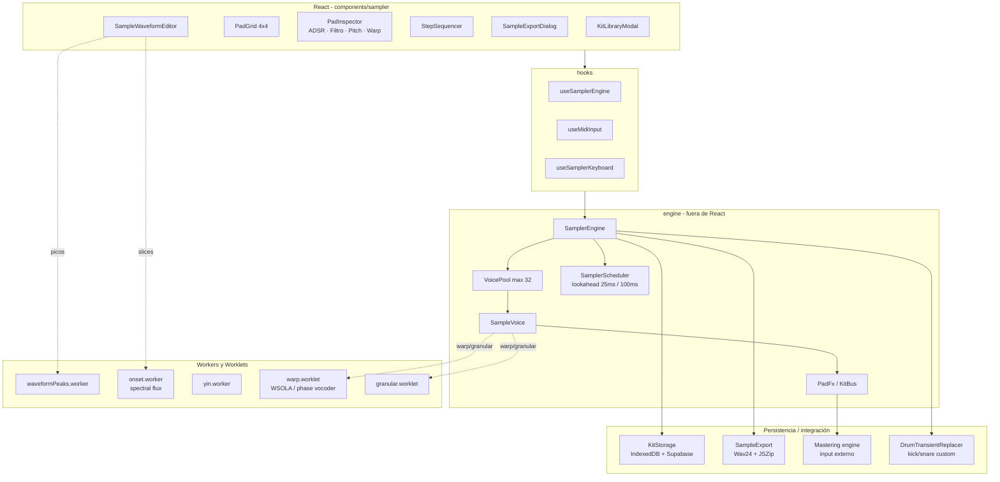

# Plan de implementación — "Sample Lab" (opción de SAMPLEO en Mastering Pro)

> Objetivo: **crear sonidos a partir de un audio cargado** (cortar, filtrar, afinar, estirar, tocar con pads/teclado/MIDI, secuenciar y exportar), integrado con el módulo Mastering Pro y el resto de Tandao Live Hub.
> Estado: **propuesta / plan** — no hay código escrito. Documento hermano: [`01_AUDITORIA_Y_PROPUESTA_DE_MEJORA.md`](./01_AUDITORIA_Y_PROPUESTA_DE_MEJORA.md).
> Stack actual: React 19 + Vite 7 + Tauri 2 (WebView2/Chromium en Windows), WebAudio nativo, `jszip`, `lamejs`, `music-tempo`, Supabase, `workers/tempoWorker.ts`, `utils/beatGridDSP.ts`, `Wav24BitEncoder`.

---

## 1. Visión y alcance

### 1.1 Qué podrá hacer el usuario (historias de usuario)

| ID | Historia | Fase |
|---|---|---|
| U1 | Cargar/arrastrar un audio (o usar la pista ya cargada en el rack, o un stem) y ver su forma de onda con zoom | F1 |
| U2 | Seleccionar una región, ajustar inicio/fin con precisión (snap a cruce por cero, a transitorio o a rejilla BPM) y **escucharla en bucle** | F1 |
| U3 | **Cortar automáticamente** en slices por transitorios o por rejilla (1/4, 1/8, 1/16) y asignarlos a 16 pads | F1–F2 |
| U4 | Tocar los pads con ratón/touch, teclado del ordenador y **teclado/pads MIDI** con velocidad | F2 |
| U5 | Por pad: ganancia, pan, afinación (±24 st + fino), reverse, modo *one-shot / gate / loop*, envolvente ADSR, filtro LP/HP/BP, grupo de *choke* | F2 |
| U6 | Modo **cromático**: un sample tocado en todo el teclado (nota raíz) | F2 |
| U7 | **Estirar tiempo / cambiar tono por separado** (warp) y ajustar al BPM del proyecto | F3 |
| U8 | **Diseño de sonido creativo**: Granular (nube de granos), *Freeze*, *Paulstretch* (pads ambientales) | F3 |
| U9 | **Secuenciador de 16 pasos** por pad, BPM, swing; grabar la interpretación cuantizada | F4 |
| U10 | **Exportar**: sample único WAV 24-bit, pack de slices (ZIP + manifiesto), *bounce* de loop/patrón | F5 |
| U11 | Guardar/cargar **kits** (local + nube) y enviar un sample a *Drum Layering* como kick/snare personalizado | F5 |
| U12 | Pasar la salida del sampler **por la cadena de Mastering** (o enviar el bounce como stem al rack) | F5 |

### 1.2 Fuera de alcance (v1)
Multisampling con zonas por velocidad/nota (v2), plugins VST, edición espectral (v3), separación de stems en el propio módulo (se reutiliza la ya existente en StemStudio).

### 1.3 Principios de diseño
1. **Sin clics, sin latencia notable**: fades de ≥2 ms, snap a cruce por cero, scheduling por reloj de audio.
2. **Mismo DSP en vivo y en export** (lección de la auditoría): los procesos se escriben una vez y se ejecutan tanto en `AudioContext` como en `OfflineAudioContext`.
3. **No bloquear la UI**: análisis (picos de onda, transitorios, YIN) en Web Workers.
4. **Datos del usuario seguros**: kits en IndexedDB; la nube es opcional y con RLS por usuario.
5. **Derechos de autor**: se guarda la procedencia (archivo origen, región) en el kit y se muestra un aviso de "usa solo material propio o con licencia". No se añade ninguna función para ocultar el origen del material.

---

## 2. Arquitectura



### 2.1 Estructura de archivos nueva

```
desktop-client/src/modules/mastering-pro/sampler/
├─ index.ts
├─ types/sampler.types.ts
├─ engine/
│  ├─ SamplerEngine.ts            # dueño del contexto de audio, buses y voces
│  ├─ SampleVoice.ts              # 1 voz: source → filtro → ADSR → pan
│  ├─ VoicePool.ts                # polifonía, robo de voz, choke groups
│  ├─ SamplerScheduler.ts         # reloj lookahead (usa tempoWorker)
│  ├─ SampleBufferOps.ts          # recorte, fades, normalizar, reverse, DC, zero-cross
│  ├─ LoopCrossfade.ts            # loop sin clic (equal-power)
│  ├─ OnsetDetector.ts            # spectral flux (compartido con DrumTransientReplacer)
│  ├─ Slicer.ts                   # slices por transitorio / rejilla / manual
│  ├─ PitchDetector.ts            # YIN → nota raíz sugerida
│  ├─ SampleExport.ts             # WAV24 / ZIP / manifest.json / bounce offline
│  ├─ KitStorage.ts               # IndexedDB (+ sync Supabase)
│  └─ worklets/
│     ├─ warp.worklet.ts          # WSOLA (percusivo) + phase vocoder (tonal)
│     └─ granular.worklet.ts      # nube de granos / freeze / paulstretch
├─ workers/
│  ├─ waveformPeaks.worker.ts     # pirámide min/max por nivel de zoom
│  ├─ onset.worker.ts
│  └─ yin.worker.ts
├─ hooks/
│  ├─ useSamplerEngine.ts
│  ├─ useMidiInput.ts             # Web MIDI IN (notas, velocity, CC)
│  └─ useSamplerKeyboard.ts       # mapeo QWERTY → pads
└─ components/
   ├─ SampleLabPanel.tsx          # contenedor (pestaña en MasteringRack + ruta /sample-lab)
   ├─ SampleWaveformEditor.tsx
   ├─ SliceToolbar.tsx
   ├─ PadGrid.tsx
   ├─ PadInspector.tsx
   ├─ StepSequencer.tsx
   ├─ SampleExportDialog.tsx
   └─ KitLibraryModal.tsx
```

Cambios en código existente (mínimos y localizados):
| Archivo | Cambio |
|---|---|
| `mastering-pro/index.ts` | Reexportar `sampler/` |
| `engine/WebAudioMasteringEngine.ts` | `getAudioContext()`, `getAudioBuffer()` (ya existe), `connectExternalSource(node)` para enrutar el sampler por la cadena de mastering, `setCustomDrumSampleFromBuffer(type, buffer, name)` |
| `engine/DrumTransientReplacerDSP.ts` | Aceptar `AudioBuffer` directo (hoy solo `File`) |
| `components/MasteringRack.tsx` | Nueva pestaña/acordeón "SAMPLE LAB" (lazy) |
| `App.tsx` | Ruta opcional lazy `/sample-lab` (misma `ProtectedRoute`) |
| `services/supabaseMasteringService.ts` | (Fase 5) funciones de kits |

---

## 3. Modelo de datos (`types/sampler.types.ts`)

```ts
export type PlayMode = 'oneshot' | 'gate' | 'loop';
export type WarpMode = 'off' | 'varispeed' | 'wsola' | 'phasevocoder';
export type SliceSource = 'manual' | 'transient' | 'grid';

export interface SampleSource {            // audio madre (inmutable)
  id: string;
  name: string;
  origin: 'mastering-buffer' | 'file' | 'stem' | 'recording';
  buffer: AudioBuffer;                     // 32f, sampleRate del contexto (48 kHz)
  bpm?: number;                            // detectado / editable
  rootNote?: number;                       // MIDI 0-127 (YIN)
  provenance?: { fileName?: string; songId?: string; stemRole?: string };
}

export interface SampleRegion {            // fragmento del audio madre
  id: string;
  sourceId: string;
  startSec: number;
  endSec: number;
  loopStartSec?: number;
  loopEndSec?: number;
  loopCrossfadeMs: number;                 // 0–50
  sliceSource: SliceSource;
}

export interface Adsr { attackMs: number; decayMs: number; sustain: number; releaseMs: number; }

export interface PadVoiceParams {
  gainDb: number;                          // −48…+12
  pan: number;                             // −1…+1
  pitchSemis: number;                      // −24…+24
  fineCents: number;                       // −100…+100
  reverse: boolean;
  playMode: PlayMode;
  chokeGroup: number | null;               // 1–8
  amp: Adsr;
  filter: { type: 'off'|'lowpass'|'highpass'|'bandpass'; cutoffHz: number; q: number; envAmountOct: number; env: Adsr };
  warp: { mode: WarpMode; targetBpm?: number; formantPreserve: boolean };
  sends: { reverb: number; delay: number };
  velocitySens: number;                    // 0–1
}

export interface SamplePad {
  index: number;                           // 0–15
  regionId: string | null;
  label: string;
  colorHex: string;
  params: PadVoiceParams;
  midiNote: number;                        // por defecto 36 + index (GM)
  keyboardKey: string;                     // p. ej. '1','2','3','4','q',…
}

export interface SamplerPattern {
  bpm: number; swing: number; steps: 16 | 32;
  lanes: Array<{ padIndex: number; steps: Array<{ on: boolean; velocity: number; probability?: number }> }>;
}

export interface SampleKit {
  schemaVersion: 1;
  id: string; name: string;
  sources: Array<Omit<SampleSource,'buffer'> & { wavBlobKey: string }>;
  regions: SampleRegion[]; pads: SamplePad[]; pattern?: SamplerPattern;
  createdAt: string; updatedAt: string;
}
```

---

## 4. Diseño técnico por componente

### 4.1 `SamplerEngine`
- Recibe `AudioContext` (el del rack mediante `getAudioContext()`, o uno propio a 48 kHz si se usa en `/sample-lab`).
- Grafo: `voices → padGain/pan → kitBus → [sendReverb|sendDelay] → sumBus → safetyLimiter → output` donde `output` va a (a) `destination` (monitoreo directo) o (b) `masteringEngine.inputNode` (modo "masterizar el sampler").
- API pública:
```ts
class SamplerEngine {
  constructor(ctx: BaseAudioContext, out: AudioNode);
  loadSource(src: SampleSource): Promise<void>;
  setPad(i: number, patch: Partial<SamplePad>): void;
  trigger(i: number, velocity01: number, whenSec?: number): VoiceHandle;
  release(i: number, whenSec?: number): void;
  stopAll(fadeMs?: number): void;
  playChromatic(note: number, vel: number, regionId: string): VoiceHandle;
  auditionRegion(region: SampleRegion, loop: boolean): void;
  renderOffline(job: BounceJob): Promise<AudioBuffer>;     // mismo grafo en OfflineAudioContext
  dispose(): void;
}
```

### 4.2 `SampleVoice` (cadena por voz)
`AudioBufferSourceNode(start(when, offset, duration), playbackRate = 2^((semis+cents/100)/12), loop/loopStart/loopEnd)` → `BiquadFilterNode` (frecuencia modulada por ADSR en octavas con `setTargetAtTime`) → `GainNode` ADSR (rampas exponenciales, mínimo 2 ms) → `StereoPannerNode` → `padBus`.
- *Reverse*: buffer invertido cacheado por región (se calcula una vez).
- *Gate*: `release()` lanza la fase R; *one-shot*: ignora note-off; *loop*: `loop=true` con crossfade.
- *Warp ≠ off*: la fuente es el worklet `warp` (ver 4.6) en vez de `playbackRate`.
- Limpieza: `source.onended` desconecta nodos (evita fugas con miles de golpes).

### 4.3 `VoicePool`
Máx. 32 voces. Robo de voz: la más antigua en fase *release* → si no hay, la más antigua; fade de robo 5 ms. *Choke groups* (hi-hat abierto/cerrado): `trigger` en un grupo libera todas las voces del mismo grupo con fade 8 ms.

### 4.4 `SamplerScheduler` (secuenciador y *quantize*)
Reloj *lookahead* clásico: tick cada 25 ms desde `workers/tempoWorker.ts` (no `setTimeout` del hilo principal, que se ralentiza en pestañas inactivas), agenda eventos hasta `currentTime + 0.1 s` con `source.start(when)`. Swing = retraso de los pasos pares `swing·stepDur/3`. Grabación: marca `ctx.currentTime` del evento y cuantiza a 1/16 (o libre).

### 4.5 Detección: `OnsetDetector` + `Slicer` (en worker)
- STFT 1024/hop 256, magnitud en escala log (`log(1+γ·|X|)`), **flujo espectral** positivo, umbral adaptativo = mediana móvil (±0.1 s) × k + offset; *peak-picking* con distancia mínima configurable (30–120 ms); refinar cada onset retrocediendo al **mínimo local de energía previa** y luego al **cruce por cero** más cercano.
- Control de sensibilidad (slider) que recalcula solo el *peak-picking* (no la STFT).
- Clasificación opcional por centroide espectral/ratio de banda baja para sugerir bombo / caja / hat y auto-asignar pads (kick → pad 0, snare → pad 1, hat → pad 2…).
- Modo rejilla: usa `bpm` (de `utils/beatDetector`/`music-tempo` o manual) y `offset` de primer pulso; subdivisiones 1/4, 1/8, 1/16, tresillo.
- **Reutilización**: este mismo detector sustituye a `detectDrumTransients` (mejora de la auditoría §3.8): menor retardo, ejecución en worker.

### 4.6 Warp / Granular (AudioWorklet)
Estrategia por niveles para entregar valor pronto:
| Nivel | Técnica | Uso | Fase |
|---|---|---|---|
| 0 | *Varispeed* (`playbackRate`) | tono y velocidad juntos (efecto "sampler clásico") | F2 |
| 1 | **WSOLA** (solapamiento-suma con alineación por correlación) | estirar percusivo/loops con calidad aceptable; ventana 20–40 ms | F3 |
| 2 | **Phase vocoder** (STFT 2048/hop 512, *phase locking* de picos) | material tonal/vocal; opción *formant preserve* (cepstral liftering) | F3 |
| 3 | **Granular** (posición, tamaño 10–500 ms, densidad, jitter, spread de pitch, ventana Hann) y **Paulstretch** (stretch ×8–×100, fase aleatoria) | pads/texturas a partir del audio | F3 |
- Licencias: **evitar Rubber Band (GPL)** y SoundTouch (LGPL, enlace complicado en bundle web). Implementación propia (≈ 300–500 líneas) o dependencia MIT/BSD tras revisión legal.
- El DSP vive en `dsp-core` puro (funciones sobre `Float32Array`) y el *Processor* es una envoltura fina ⇒ el **bounce offline** usa exactamente el mismo código.
- Carga: `import url from './warp.worklet.ts?worker&url'` + `ctx.audioWorklet.addModule(url)`; verificar CSP de Tauri (`worker-src blob:`), y que funciona en `OfflineAudioContext`.

### 4.7 `SampleBufferOps`
`trim(buf, start, end)`, `fadeIn/Out(ms, curva)`, `normalize(peak|rms)`, `reverse`, `removeDC`, `toMono/toStereo`, `snapToZeroCrossing(buf, sec, radiusMs)`, `detectSilence`. Todas devuelven un `AudioBuffer` nuevo o *vista* (`subarray`) para no duplicar memoria de pistas largas.

### 4.8 `LoopCrossfade`
Para un bucle `[ls, le]`: mezclar `crossfadeMs` finales con los previos al inicio (ley *equal-power*), de modo que `y[le] ≈ y[ls]`. Verificación automática: discontinuidad en el punto de bucle < −60 dBFS relativo al RMS.

### 4.9 `PitchDetector` (YIN, worker)
Detecta la fundamental del segmento (50 Hz–2 kHz), propone nota raíz MIDI + desviación en cents ⇒ el modo cromático queda afinado y se puede "auto-afinar a la tonalidad".

### 4.10 UI/UX
- **`SampleWaveformEditor`**: `<canvas>` con `devicePixelRatio`, pirámide de picos min/max precalculada en worker (niveles 1:64, 1:256, 1:1024, 1:4096); zoom con rueda (centrado en cursor), scroll horizontal, selección arrastrable con asas, marcadores de slice arrastrables (doble clic crea/elimina), cabezal de reproducción, rejilla BPM, *snap* conmutable (cero / transitorio / rejilla). Atajos: `Espacio` play/stop región, `L` loop, `S` slice en cursor, `Del` borra marcador, `←/→` nudge 1 muestra (`Shift` = 10 ms).
- **`PadGrid`**: 4×4, color por pad, indicador de velocidad y de voces activas, arrastrar-soltar slice/región sobre un pad, clic derecho = menú (reverse, limpiar, copiar). Teclas por defecto `1 2 3 4 / Q W E R / A S D F / Z X C V`. Accesible: `role="button"`, `aria-label`, foco visible, `aria-pressed`.
- **`PadInspector`**: pestañas *Sample / Amp / Filter / Pitch-Warp / FX*; controles con valor numérico editable y *reset* con doble clic.
- **`StepSequencer`**: matriz 16×16 (pads × pasos), velocidad por paso, BPM, swing, play/stop/grabar, *clear/copy/paste*.
- **Estilo**: coherente con el rack actual (tokens `#FF6B00`, Tailwind 4). Textos en español. Estados vacío/cargando/error explícitos.
- **Rendimiento UI**: estado de audio fuera de React (refs + `useSyncExternalStore`), actualizaciones de UI ≤ 30 fps, `React.memo` por pad.

### 4.11 Integraciones
1. **Fuente**: botón "Usar pista del rack" (`mastering.getAudioBuffer()`), selector de stems del proyecto (reutiliza `fetchProjectAudioTracksForMastering`), arrastrar archivo, **grabar la salida** del rack con `MediaStreamAudioDestinationNode` + `MediaRecorder` o captura offline del grafo.
2. **Drum Layering**: acción "Usar como kick/snare" en un pad ⇒ `setCustomDrumSampleFromBuffer`.
3. **Mastering de la salida del sampler**: conmutador "Enrutar por cadena Mastering Pro" ⇒ `connectExternalSource`. Bounce → "Enviar al rack como pista/stem 'other'".
4. **Nube**: kits en Supabase (§6) y opcional "compartir con el proyecto/canción".

---

## 5. Exportación (`SampleExport`)

| Salida | Detalle |
|---|---|
| Sample único | WAV 24-bit/48 kHz (reutiliza `Wav24BitEncoder`; dither TPDF ±1 LSB según auditoría), con fades y normalización opcionales |
| Pack de slices | ZIP (`jszip`) con `NN_nombre.wav` + `kit.json` (manifiesto: pad, nota MIDI, ADSR, pitch, procedencia) |
| Bounce de patrón/loop | `renderOffline` en `OfflineAudioContext` con N compases + cola de release; opción "loop perfecto" (recorta a múltiplo de compás + crossfade) |
| Formato extra | MP3 vía `lamejs` (ya en el proyecto) y SFZ básico (v2) |
| Guardado | Tauri: diálogo de archivo (`@tauri-apps/plugin-fs`/`dialog` a añadir) con *fallback* a descarga en navegador |
| Metadatos | WAV `smpl`/`cue` chunk (nota raíz, loop points, cue de slices) para compatibilidad con DAWs/samplers |

---

## 6. Persistencia y backend

- **Local**: IndexedDB (`sampler_kits`, `sampler_sources`): audio madre como WAV 24-bit/FLAC-like Blob + JSON del kit (no usar `localStorage`: cuota ~5 MB; el módulo actual ya la toca con snapshots).
- **Supabase** (Fase 5, opcional):
```sql
create table if not exists public.sample_kits (
  id uuid primary key default gen_random_uuid(),
  user_id uuid not null references auth.users(id) on delete cascade,
  song_id uuid null,
  name text not null,
  kit_json jsonb not null,
  total_bytes bigint not null default 0,
  created_at timestamptz not null default now(),
  updated_at timestamptz not null default now()
);
alter table public.sample_kits enable row level security;
create policy "kits_owner_select" on public.sample_kits for select using (auth.uid() = user_id);
create policy "kits_owner_write"  on public.sample_kits for all    using (auth.uid() = user_id) with check (auth.uid() = user_id);
-- Bucket privado 'samples' (carpeta = user_id/kit_id/…), políticas por prefijo de user_id
```
- Autoguardado del kit con *debounce* de 2 s; versión de esquema (`schemaVersion`) con migraciones.

---

## 7. Fases, entregables y criterios de aceptación

> Estimaciones en días-persona de un ingeniero con experiencia en WebAudio/React (± 25 %).

### Fase 0 — Cimientos (3 d)
- Carpeta `sampler/`, tipos, `SamplerEngine` esqueleto, enrutado (`getAudioContext`, `connectExternalSource`).
- Infra de **workers y worklets** con Vite (`?worker&url`), validación en `tauri dev` **y build de producción**.
- Harness de pruebas (Vitest + Chrome headless, reutilizando `docs/mastering-pro/evidence/`).
- **Aceptación**: un worklet "hola mundo" carga en `AudioContext` y en `OfflineAudioContext` en el build de Tauri.

### Fase 1 — MVP: cargar, ver, seleccionar, escuchar, cortar (8–10 d)
- Fuentes (archivo, pista del rack, stem), decodificación a 48 kHz.
- `waveformPeaks.worker` + `SampleWaveformEditor` (zoom, selección, snap a cero, cabezal).
- Audición de región con/sin bucle y `LoopCrossfade`.
- `OnsetDetector` + `Slicer` (transitorios y rejilla BPM) en worker; sensibilidad ajustable.
- Exportar región (WAV 24-bit) — primer valor tangible.
- **Aceptación**: F-measure ≥ 0.95 (tolerancia ±10 ms) en un loop de batería sintético de 120 BPM; bucle sin clic (discontinuidad < −60 dB); abrir una pista de 5 min < 1.5 s hasta ver la onda; UI ≥ 55 fps al hacer zoom.

### Fase 2 — Pads, voces y control (6–7 d)
- `SampleVoice`, `VoicePool` (32 voces, robo, choke), `PadGrid`, `PadInspector` (ADSR, filtro, pitch, pan, ganancia, reverse, modos).
- Teclado QWERTY (`useSamplerKeyboard`) y **Web MIDI** (`useMidiInput`: note on/off, velocity, CC → macros).
- Modo cromático con nota raíz (YIN).
- **Aceptación**: latencia pad→sonido ≤ 20 ms medida (WebView2); 32 voces simultáneas con CPU < 25 % y sin clics al robar voces; transposición exacta (±1 cent) verificada por FFT.

### Fase 3 — Warp y diseño de sonido (8–10 d)
- `warp.worklet` (WSOLA + phase vocoder), ajuste a BPM, *formant preserve*.
- `granular.worklet` (grano, *freeze*) y **Paulstretch**.
- Presets de textura ("Pad etéreo", "Riser", "Glitch", "Tape stop").
- **Aceptación**: estirado ×0.5–×2 con error de tono < 5 cents y sin "flanging" audible en loops de batería (revisión con A/B ciego interno); granular estable (sin NaN) a 64 granos simultáneos; paridad en vivo = offline (null test ≤ −80 dB).

### Fase 4 — Secuenciador y grabación (6 d)
- `SamplerScheduler` + `StepSequencer` (16/32 pasos, swing, velocidad por paso), grabación en tiempo real con cuantización.
- **Aceptación**: jitter de disparo < 1 ms (medido en `OfflineAudioContext`) y < 3 ms de deriva tras 10 min a 120 BPM.

### Fase 5 — Export, kits, nube e integración (5–6 d)
- ZIP de slices + `kit.json`, bounce offline, MP3, chunks `smpl/cue`.
- `KitStorage` (IndexedDB) + Supabase (opcional) + RLS.
- Integración con Drum Layering y con la cadena de Mastering.
- **Aceptación**: el *bounce* offline coincide con la captura en tiempo real (null ≤ −90 dB); abrir el ZIP exportado en un DAW (Reaper/Ableton) respeta nombres y loop points; kit guardado y recargado idéntico (hash de JSON).

### Fase 6 — Calidad, accesibilidad y pulido (4 d)
- Tests de regresión, accesibilidad por teclado/lector de pantalla, estados de error, textos en español, documentación de usuario y atajos.

**Total estimado: 40–46 días-persona** (≈ 8–9 semanas con una persona; ≈ 5 con dos en paralelo: UI y DSP).

---

## 8. Plan de pruebas

| Capa | Prueba | Herramienta |
|---|---|---|
| Unidad DSP | Zero-cross snap, fades, normalize, loop crossfade (discontinuidad), YIN (±3 cents con senos 80 Hz–2 kHz), spectral flux (F-measure) | Vitest + datos sintéticos |
| Integración audio | Paridad vivo/offline (null test), transposición por FFT, jitter del scheduler, voces simultáneas | Chrome headless (harness de `evidence/`) |
| E2E UI | Cargar archivo → cortar → asignar → tocar → exportar ZIP | Playwright contra `vite dev` |
| Rendimiento | Pista de 10 min: carga, zoom, memoria < 400 MB; 32 voces CPU | `performance.measure`, Chrome tracing |
| Compatibilidad | WebView2 (Windows) obligatorio; WKWebView (macOS) si se distribuye | Matriz manual |
| Accesibilidad | Navegación por teclado completa, contraste WCAG AA | axe-core |

---

## 9. Riesgos y mitigaciones

| Riesgo | Prob. | Impacto | Mitigación |
|---|---|---|---|
| Worklets/CSP en build de Tauri | Media | Alto | Spike en Fase 0 con build real |
| Calidad del warp insuficiente (artefactos) | Media | Medio | Entregar varispeed+WSOLA primero; fase vocoder opcional; A/B interno |
| Memoria con pistas largas (copias de buffers) | Media | Medio | Vistas `subarray`, regiones como offsets, decodificar una vez, liberar al cerrar |
| Latencia de audio en Windows | Media | Medio | `latencyHint:'interactive'`, medir `baseLatency/outputLatency`, ASIO fuera de alcance |
| Permiso Web MIDI en WebView2 | Baja | Medio | Detección de capacidad + UI de ayuda; teclado QWERTY siempre disponible |
| Derechos de autor del material cargado | — | Alto | Aviso en UI, procedencia en el kit, sin funciones de ocultación de origen |
| Alcance (feature creep) | Alta | Medio | Congelar v1 en U1–U12; multisampling/espectral → v2 |
| Interferencia con el motor de mastering (mismo `AudioContext`) | Media | Medio | El sampler con bus propio y límite de seguridad; conexión externa opcional |

---

## 10. Dependencias y decisiones por confirmar

1. **¿Módulo dentro de Mastering Pro (pestaña) y/o ruta propia `/sample-lab`?** Propuesta: ambas (mismo componente lazy).
2. **Prioridad entre auditoría P0 y Sampler.** Propuesta: Fase 0 del sampler comparte infraestructura (worklets/medición) con P0.1 de la auditoría ⇒ hacerlas juntas.
3. **Warp**: ¿implementación propia (recomendado) o dependencia con licencia permisiva?
4. **Nube**: ¿kits en Supabase desde v1 o solo local?
5. **Dependencias nuevas** (a aprobar): `@tauri-apps/plugin-dialog`, `@tauri-apps/plugin-fs`, `vitest`, `@playwright/test` (dev).
6. **Ámbito MIDI**: ¿solo entrada (notas/CC) o también salida/clock?

---

## 11. Definición de "hecho" (v1)

- U1–U12 cumplidas y cubiertas por pruebas automáticas de §8.
- Sin clics audibles en: inicio/fin de región, bucles, robo de voz y cambios de parámetro.
- Latencia pad→audio ≤ 20 ms; 32 voces estables.
- Bounce offline ≡ tiempo real (≤ −90 dB de residuo).
- Documentación de usuario + atajos + `CHANGELOG`.
- Revisión legal del aviso de derechos y de licencias de dependencias.
